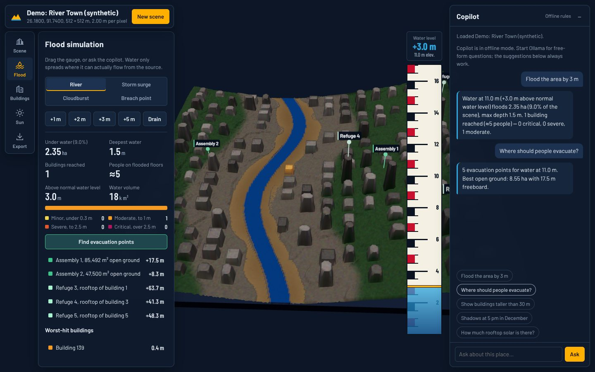
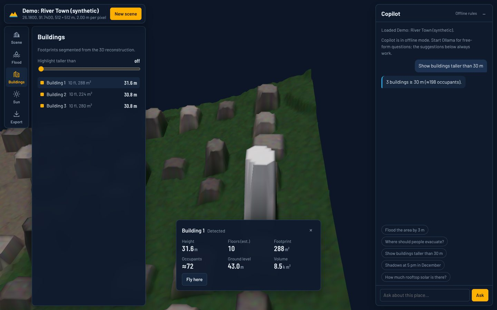
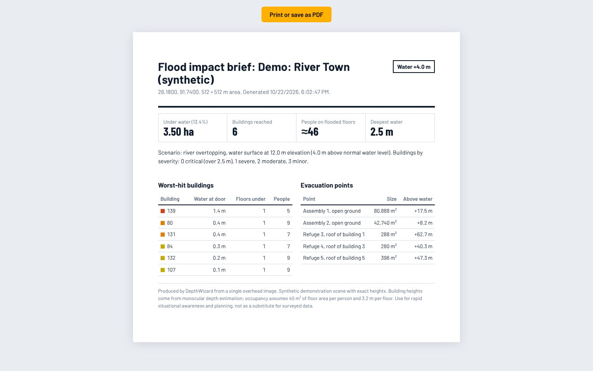

# DepthWizard

**Turn one overhead image into a measurable 3D twin of a neighbourhood. Then raise the river, see which buildings flood, find where people should go, and plan rooftop solar, all in the browser.**



Disaster teams and city planners rarely have LiDAR or stereo imagery for the place they need right now. They usually have a satellite or drone picture. DepthWizard reconstructs the 3D surface from that single image with a monocular depth model. It anchors the surface to real terrain and real building heights from free open data, then runs the analyses that decide things:

| Question | What DepthWizard does |
|---|---|
| *If the river rises 3 m, who is affected?* | Hydraulically connected flood fill from the river (not a naive "everything below X" threshold). It reports flooded area, buildings reached, water depth at each door, severity and people on flooded floors. |
| *Where should people go?* | Ranks dry open ground and tall rooftops by freeboard above the water and marks them in 3D. |
| *What if an embankment breaks here, or a cloudburst hits?* | Four water sources: river, storm surge from every edge, cloudburst ponding, or a breach point you click. |
| *Which slopes are dangerous?* | Slope classes on the bare-earth model (under 15°, 15–30°, over 30°). |
| *How much rooftop solar does this block have?* | Shadow-aware annual yield per roof, ray-marched through the reconstructed city, so a tower shading its neighbour counts. |
| *Can I just ask?* | A copilot turns "flood the area by 3 m and show evacuation points" into actions. A free local LLM picks the actions; every number comes from the analytics code, so it can't hallucinate a head count. |

Results leave the app as a printable **impact brief**, a **GLB model you can open in AR on a phone** (scan the QR code), a **3D-printable STL**, or **GeoJSON** for GIS tools.

<p>


</p>

---

## Quickstart

### Windows
```bat
setup_laptop.bat     :: one time; installs CUDA PyTorch automatically if an NVIDIA GPU is present
start_server.bat     :: opens http://localhost:8000
```

### Linux / macOS
```bash
./setup.sh && ./start.sh
```

### Docker / Hugging Face Spaces
```bash
docker build -t depthwizard . && docker run -p 7860:7860 depthwizard
```
The image is CPU-only and listens on port 7860, the Hugging Face Spaces Docker default.

The app opens on an offline demo scene, a synthetic river town with exact heights, so it works with no internet and no model download. Click **New scene** to:
- **Pick on map:** search a place or choose a preset (Srinagar, Guwahati, Patna, Chennai, Mumbai, Kochi, Shimla and more), then **Build 3D twin**. The satellite imagery, terrain and OpenStreetMap buildings are fetched automatically, all free with no API keys.
- **Upload image:** a drone photo, a satellite screenshot or a GeoTIFF. GeoTIFFs are placed on the map automatically.

### Hardware
| Setup | Model | Time per 1.2 km scene |
|---|---|---|
| CPU laptop | `DW_MODEL_SIZE=small` (default) | about 60 s, mostly downloads; depth takes about 10–20 s |
| 6 GB NVIDIA GPU | `DW_MODEL_SIZE=base` (set automatically by the start scripts; the Base weights are CC-BY-NC, which is fine for hackathons and research) | a few seconds of inference |

### Free AI copilot (optional)
The copilot always works with its built-in offline parser for the suggested prompts. For free-form questions, run a local model with [Ollama](https://ollama.com):
```bash
ollama pull qwen2.5:3b        # about 2 GB; fits next to the depth model on a 6 GB GPU
```
Any OpenAI-compatible endpoint works too, including free hosted tiers:
```bash
DW_LLM_BASE_URL=https://api.groq.com/openai/v1  DW_LLM_API_KEY=...  DW_LLM_MODEL=llama-3.1-8b-instant
```

### Phone AR
The Export tab shows a QR code for the laptop's LAN address. A phone on the same Wi-Fi opens an interactive 3D model, and iOS Quick Look AR works over plain HTTP. Android's WebXR and Scene Viewer need HTTPS, so for a stage demo run a free tunnel and tell DepthWizard its public URL:
```bash
cloudflared tunnel --url http://localhost:8000      # prints https://<name>.trycloudflare.com
DW_PUBLIC_URL=https://<name>.trycloudflare.com ./start.sh
```

### Pre-bake scenes before a demo
Venue Wi-Fi is unreliable, so build scenes ahead of time. They appear under **Recent scenes**:
```bash
python dw.py presets                                   # every preset place
python dw.py map --lat 26.192 --lon 91.747 --size 1200 --name "Guwahati"
python dw.py image drone.jpg --gsd 0.3
```

---

## How it works

```
 satellite tiles ──┐                        ┌── OpenStreetMap footprints + height tags
 or uploaded image │                        │   (fetched in parallel with inference)
                   ▼                        ▼
        Depth Anything V2 ──► split: terrain tilt │ structures ──► metric DSM ──► analytics
                                  (morphological opening)          ▲             ground, buildings,
 AWS Terrain Tiles (SRTM) ─────────────────────────────────────────┘             water, flood, solar
 permanent-water detection (RGB + depth + DEM) flattens rivers ────┘
```

1. **Depth.** Depth Anything V2 predicts relative depth. On overhead images it outlines buildings well but invents a perspective tilt. A large-window morphological opening separates the low-frequency tilt from the structures.
2. **Metric terrain.** Structures sit on a real bare-earth DEM from AWS Terrain Tiles (SRTM, free, no key). A median filter removes SRTM's 30 m speckle and void pits.
3. **Height scale.** One scale factor is fitted against OpenStreetMap buildings with `height` or `building:levels` tags. **Half the buildings are held out** and the app reports the error on those, so validation is independent, not circular. Without OSM coverage you can calibrate by typing the real height of any one building.
4. **Water.** Rivers and lakes are detected from colour, texture, depth flatness and DEM position, then flattened. They become the flood source, and SRTM is at its noisiest over water anyway.
5. **Buildings.** OSM footprints are used when the area is mapped; otherwise watershed segmentation of the normalised DSM. Each building gets a height (90th percentile), floors, footprint, volume and estimated occupants.
6. **Analytics.** The same Python functions serve the REST API, the copilot and the printed brief. The browser re-implements only the flood fill, so water follows the slider at 60 fps, and a test checks the two match cell for cell.

Details: [docs/ARCHITECTURE.md](docs/ARCHITECTURE.md). Measured accuracy: [docs/RESULTS.md](docs/RESULTS.md). What it can't do: [docs/LIMITATIONS.md](docs/LIMITATIONS.md). Demo script for judges: [docs/PITCH.md](docs/PITCH.md).

## Honest accuracy
Monocular depth ranks heights well, but its absolute heights are rough. On Lower Manhattan, fitted against 107 OSM-tagged buildings and checked on the 53 held out, the mean height error was **±33.5 m** (median 50%; r = 0.49). Skyscrapers are the hardest case. The app shows this number next to every calibrated scene and labels uncalibrated scenes "Assumed scale". Treat outputs as rapid situational awareness, not survey data.

## API
| Endpoint | Purpose |
|---|---|
| `POST /api/scene/map` `{west,south,east,north,name}` | Build a scene for a map area (background job) |
| `POST /api/process` (multipart: `file`, `gsd_m`, `lat`, `lon`, `name`) | Build from an uploaded image or GeoTIFF |
| `GET /api/jobs/{id}` | Live job progress |
| `GET /api/result/{id}` | Manifest, analysis, buildings and asset URLs |
| `POST /api/jobs/{id}/flood` `{level_m, source, point?}` | Flood impact report |
| `POST /api/jobs/{id}/safe_zones` | Evacuation points |
| `GET /api/jobs/{id}/solar` | Rooftop solar estimate (cached) |
| `POST /api/jobs/{id}/copilot` `{message, state}` | Natural-language control |
| `POST /api/jobs/{id}/scale` | Recalibrate heights and rebuild |
| `GET /api/jobs/{id}/model.glb`, `model.stl`, `buildings.geojson` | Exports |

## Tests
```bash
pip install -r requirements.txt   # PyTorch is not needed for the test suite
python -m pytest tests -q
```
The suite covers analytics against a synthetic town with known truth, water detection, OSM calibration recovery, watertight STL and valid GLB output, the copilot (offline rules and a mock LLM server), API security (path traversal, filename sanitising) and JS/Python flood parity through Node. It runs on every push via GitHub Actions.

## Project layout
```
api/main.py          FastAPI server + static viewer
src/pipeline.py      scene builders: map area, upload, GeoTIFF, demo
src/scene.py         depth to metric DSM, water detection, asset export
src/analytics.py     ground, buildings, flood, evacuation, slope, sun and solar
src/tiles.py         Esri imagery + AWS terrain tiles
src/osm.py           OSM footprints, height calibration with hold-out
src/copilot.py       LLM / rule intent parsing + grounded execution
src/exporters.py     GLB and STL writers
web/                 index.html, ar.html, brief.html, js/ (ES modules), css/
dw.py                command-line scene builder
```
`run_day1.py` and `run_day2.py` are the original research CLIs (relative depth, and SRTM RANSAC calibration for GeoTIFFs).

## Data and credits
- Imagery: Esri World Imagery (Esri, Maxar, Earthstar Geographics). Check Esri's terms before any commercial use.
- Terrain: AWS Terrain Tiles / Mapzen (SRTM, NED, ETOPO1 and others).
- Buildings and geocoding: © OpenStreetMap contributors (ODbL), via Overpass and Nominatim.
- Depth model: [Depth Anything V2](https://github.com/DepthAnything/Depth-Anything-V2). The Small checkpoint is Apache-2.0; check the licence of larger checkpoints before commercial use.
- 3D: Three.js, Google model-viewer, Leaflet.
